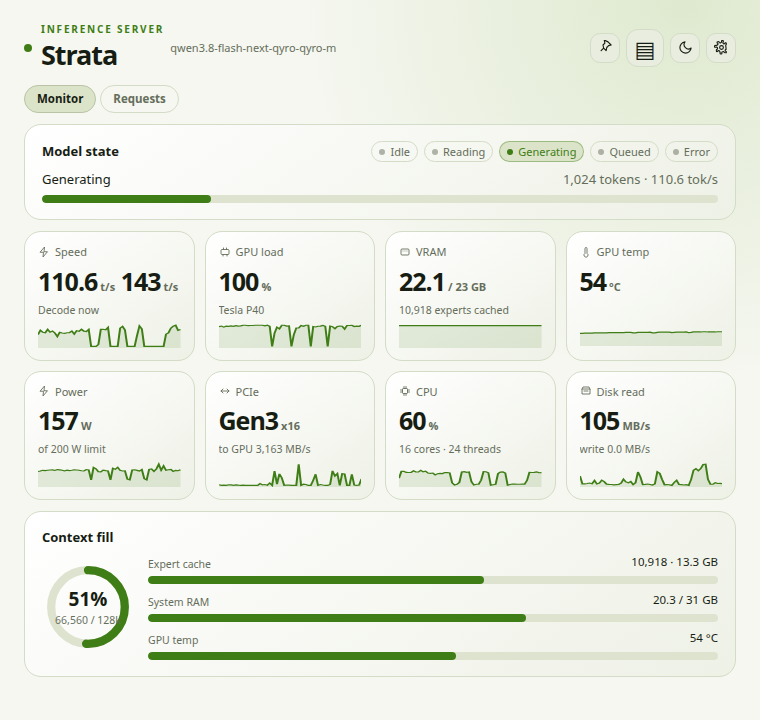
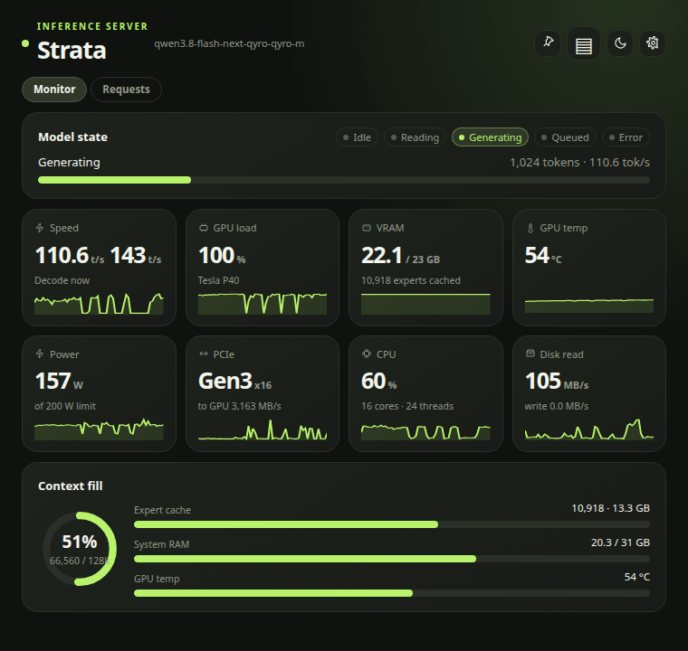
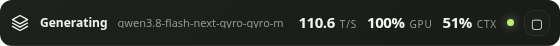

# Strata Widget

A compact, always-on-top desktop widget for the [Strata](https://github.com/Niko1221/Strata)
inference server monitor — the same Monitor view as the web dashboard, in a small
window that can float above everything. Full mode uses the native system title
bar; compact mode is a rounded, frameless strip.

## Screenshots

Monitor view, light and dark:

|  |  |
|---|---|

Compact mode — the window shrinks to a tab-bar-sized strip (560×46) showing state,
model, speed, GPU load, and context fill:

|  |  |
|---|---|

## Features

- **Live metrics** — polls `GET /metrics` (Bearer auth) every second, in the main
  process, so the server's lack of CORS headers doesn't matter.
- **The eight cards** — Speed (decode + prefill), GPU load, VRAM, GPU temp, Power,
  PCIe, CPU, Disk read, each with a sparkline from `metrics.history`.
- **Model state** — Idle / Reading / Generating / Queued / Error badges plus the
  prompt-read progress bar.
- **Context fill** — donut of prompt+output vs `max_context`, expert cache, system
  RAM, GPU temp bars.
- **Recent requests** — its own tab with a scrollable table (last 60) showing status,
  prompt/reused/output tokens, and decode t/s.
- **Compact mode** — shrinks the window to a Chrome-tab-bar-sized strip showing only
  model state, speed, GPU load, and context fill, styled to match
  [Codex Usage UI](https://github.com/wahackr/Codex-Usage-UI). Use the expand button
  to return to the full monitor; theme, pin, and settings remain in the tray menu.
  Compact mode hides the taskbar entry; full mode restores it. Click the tray icon
  or choose **Show Strata Widget** from its menu to bring the widget back.
- **Compat mode** — pin button (📌) sets always-on-top at the `screen-saver` window
  level, which floats above normal windows and fullscreen apps on both Windows and
  Linux/X11; the widget also joins all virtual desktops.
- **Dark / light theme** — moon/sun toggle, persisted. Both full and compact views
  use the Codex Usage UI palette, soft gradients, thin borders, and green accents.
- **State-aware tray icon** — the tray dot is colored by model state (idle grey,
  reading blue, generating green, queued amber, error red).
- **Cross-platform** — Electron on Windows and Linux; native title bar in full mode,
  rounded transparent corners and a drag region in compact mode, tray menu, and
  settings panel (server URL, API key, opacity, poll interval).
  Settings persist in the app's user-data directory; the API key is stored with
  OS-level encryption (`safeStorage`) where available.

## Run

```bash
npm install
npm start
```

By default the widget targets `http://127.0.0.1:8080` with no API key. Set your
Strata server URL and Bearer key in the ⚙ settings panel (saved on Save).

To run the live part of the smoke test against your server:

```bash
STRATA_URL=http://<host>:8080 STRATA_KEY=<key> npm test
```

### Linux sandbox note

Electron's SUID sandbox helper needs root ownership on some distros. If startup
aborts with `setuid_sandbox_host.cc`, either run once as root
(`sudo chown root:root node_modules/electron/dist/chrome-sandbox && sudo chmod 4755 ...`)
or launch with the sandbox disabled:

```bash
npm start -- --no-sandbox
```

### Windows

`npm install && npm start` works as-is; always-on-top and all-workspaces behavior
is handled through Electron's window API, no extra configuration.

## Layout

```
electron/main.js      window chrome, always-on-top, tray, polling, settings
electron/preload.js   contextBridge surface (no node in the renderer)
renderer/             index.html + styles.css + renderer.js (the widget UI)
test/smoke.js         headless render test against the live server + fixture
```

## Test

```bash
npm run check   # syntax check
npm test        # renders live metrics (when reachable) and the saved fixture through a DOM stub
```

## Build & release

Installers are built with [electron-builder](https://www.electron.build):

```bash
npm run build         # current platform
npm run build:linux   # AppImage + .deb
npm run build:win     # NSIS installer + portable .exe
npm run build:mac     # dmg + zip
```

GitHub Actions does the same on tagged releases:

- **CI** (`.github/workflows/ci.yml`) — `npm ci`, syntax check, and the smoke test on
  Ubuntu and Windows for every push/PR to `master`. The live-server part of the test
  is skipped automatically when the Strata server is unreachable (CI has no LAN access).
- **Release** (`.github/workflows/release.yml`) — push a `v<version>` tag (or run the
  workflow manually) to build Linux + Windows installers and publish them as a GitHub
  Release. Versions with a suffix (`v1.1.0-rc.1`) are published as prereleases.

The release binaries are unsigned, so SmartScreen / first-run warnings are expected.
